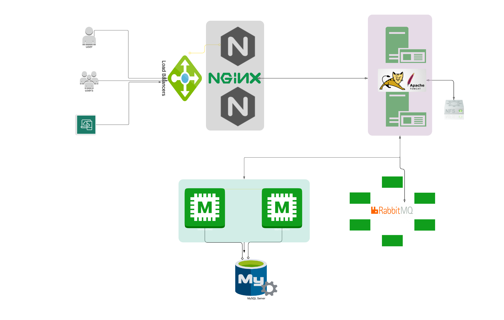
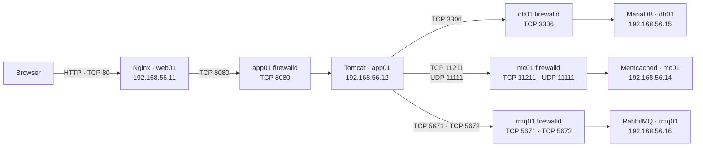
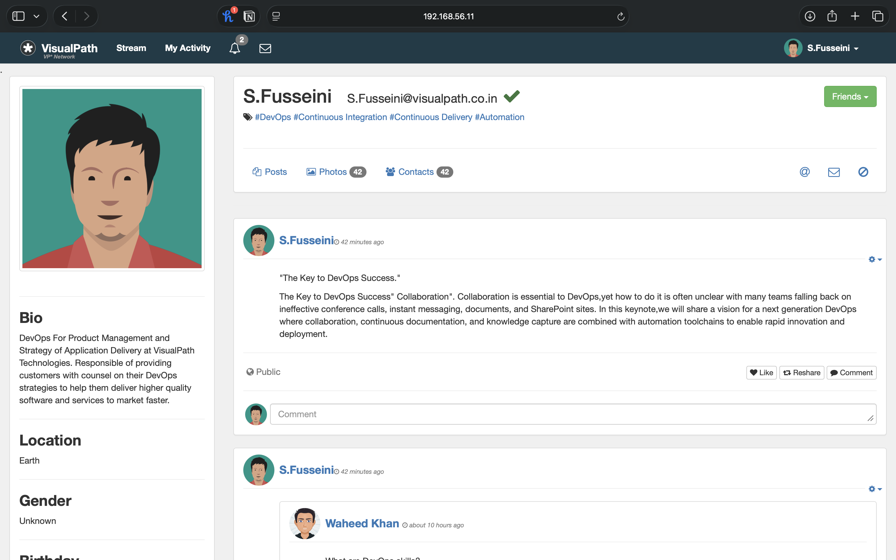

# VProfile Project — Local Mac M1 Setup

## Overview

This project runs the VProfile web application locally on an Apple Silicon Mac using Vagrant and ARM-compatible virtual machines. Nginx receives browser requests and forwards them to the Tomcat application, which uses MariaDB, Memcached, and RabbitMQ.

## Architecture

### Local services and firewall ports

### What each part does

- **Vagrant** starts and manages the project’s virtual machines.
- **Nginx** is the web front door. It receives browser requests and passes them to Tomcat.
- **Tomcat** runs the VProfile Java application and returns the pages and results.
- **MariaDB** stores lasting application data, such as account details.
- **Memcached** keeps frequently used data temporarily in memory so the app can retrieve it quickly.
- **RabbitMQ** carries messages between parts of the application when work needs to be queued.
- **firewalld** controls which network ports accept connections on the Linux VMs.

## Screenshots

### VProfile running locally

The app is available at `http://192.168.56.11` on the host Mac while the Vagrant machines are running.

## Reproduce the setup

1. Install Vagrant, VirtualBox for Apple Silicon, and the Vagrant plugins required by the `Vagrantfile`.
2. Clone this repository, then open `vagrant/Manual_provisioning`.
3. Start the virtual machines with `vagrant up`.
4. Manually configure MariaDB, Memcached, RabbitMQ, Tomcat, and Nginx by following the [Mac M1 guide](vagrant/Manual_provisioning/VprofileProjectSetupMacM1M2.pdf) in that order.
5. Open [http://192.168.56.11](http://192.168.56.11) to view the application.

The application source is cloned onto `app01` during provisioning. Keep local passwords and other secrets out of Git.
